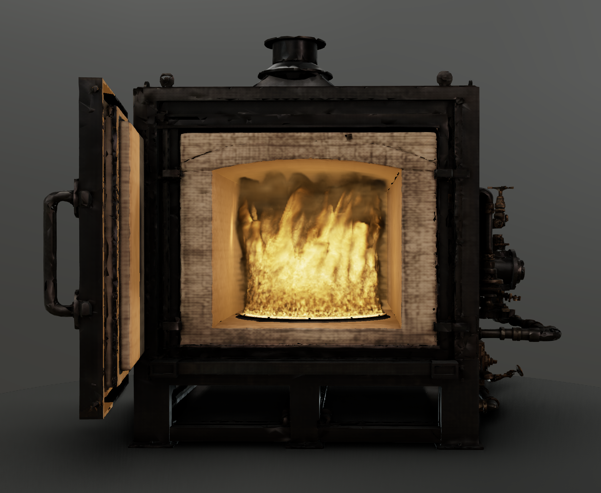

# Kaminos

Kaminos is a workbench for generating, assembling and playing with 3D worlds in the browser.

Build a creature around a skeleton. Put a burner on a moving arm. Pour water into a contraption, pull it apart, and keep working while the world runs.



**[Run the workbench locally](#run-locally) · [Browser examples](https://lyonsno.github.io/kaminos/inference-kit/) · [Combustion films](https://lyonsno.github.io/kaminos/) · [Developer guide](docs/workbench-common-main.md)**

## In the World

- **Fire and smoke.** Place and move burners, feed a reaction, and push objects through the plume. Fire catches, spreads and consumes fuel; smoke moves around the geometry.
- **Fluids.** Pour, stir and redirect liquid. Change the container or move something through it while it flows.
- **Fracture.** Grab a surface and pull. Material separates into pieces you can keep working with.
- **Creatures.** Author a body and skeleton, generate its appearance, and set it moving. Proportions shape the motion; the rig remains yours to articulate.
- **Machines.** Draw links, connect joints and pistons, and compose moving mechanisms. Give the structure a generated body without throwing away the articulation.

These systems are being brought together in a shared, editable scene. The aim is to make worlds whose materials, inhabitants and machinery can affect one another, with generation as part of building the world.

## Making Things

Start from an image, a prompt, or an authored structure. Generate a mesh, bring it into the workbench, and give it a role in the scene.

For creatures and machines, structure can come first: a skeleton or linkage establishes how something moves, while generation supplies its appearance. The pipeline connects the generated geometry back to that structure.

The **inference kiln** puts generation beside the running world. Browser inference shares the GPU with rendering and simulation through the **[WebGPU Inference Kit](webgpu-inference-kit/README.md)**. The kit also works independently: [generate your first image](models/flux2-klein/README.md#using-it-in-an-application) or choose a [model application](webgpu-inference-kit/docs/model-applications.md) for your own browser app.

## Start With Something

Open an example and change it. [Relight a photograph](https://lyonsno.github.io/kaminos/inference-kit/material-photo/) with included results before loading model weights. [Explore skeletal motion](https://lyonsno.github.io/kaminos/inference-kit/unimate/), [generate an image](https://lyonsno.github.io/kaminos/inference-kit/klein/) or [reconstruct your hand](https://lyonsno.github.io/kaminos/inference-kit/hand-mesh/) in the browser.

The kiln workshop is one starting place. You can replace its objects, build a different cast, or assemble a world with a different set of materials and rules.

## Run Locally

Serve the checkout with Python 3:

```sh
python3 serve.py 8095
```

Open [the workbench](http://127.0.0.1:8095/?workspace=workbench) in a WebGPU-capable Chromium browser. Start with the [Flame experiment](http://127.0.0.1:8095/?workspace=workbench&experiment=flame): choose and apply a preset, then select the emitter and move it while the flame runs.

Generation uses additional model packages; see [local model setup](docs/local-model-installations.md) and the [model guides](webgpu-inference-kit/README.md#one-runtime-different-models).

## Development

Kaminos is under active development. The workbench hosts both composed scenes and focused experiments in generation, motion, materials and interaction. Human controls and agent calls operate the same experiments.

- [Build a workbench experiment](docs/workbench-common-main.md)
- [Edit and save scenes](docs/scene-authoring-operations.md)
- [Workbench architecture](docs/spatial-asset-kiln.md)
- [Image-to-mesh generation](models/trellis2/README.md)
- [Splat assets](docs/splat-assets.md)
- [Testing](docs/testing.md)

For technical or collaboration inquiries, contact [Noah Lyons](https://github.com/lyonsno).
