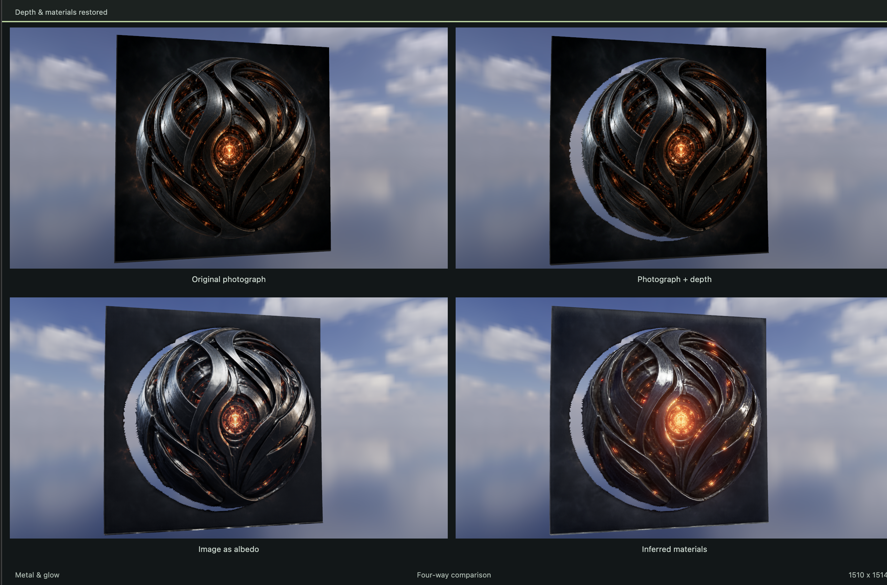

# Material Photograph

Turn a photograph into a surface you can relight.



MoGe-2 recovers depth and normals. SuperMat estimates albedo, roughness and metalness. The four synchronized views separate what each contributes: an unchanged photograph on a flat plane, the photograph on recovered geometry, that geometry lit with the photograph as albedo, and the surface lit with inferred materials.

Orbit the views together, enlarge one, move the light, or change the HDR environment. The tuning panel exposes material contrast, screen-space GI and AO, and optional heuristic glow extraction with bloom. Material inference supports 512, 768 and 1024 pixel square outputs. Completed results are retained in browser storage when available, so returning to an image and resolution can restore them without another run.

## Run Locally

This example currently requires a local Kaminos checkout and a prepared SuperMat WebGPU weight package. MoGe weights download automatically; SuperMat weights are separate from the repository and npm package.

1. Prepare the SuperMat package with [pack-weights.py](../../models/supermat/pack-weights.py). Its inputs are the SuperMat checkpoint, the Stable Diffusion 2.1 VAE and conditioning exported by [export-reference.py](../../models/supermat/export-reference.py). Use the packer's `--dtype f16` and `--chunk-bytes 16777216` options for the chunked FP16 route.
2. Make that package directory available as `scratch/supermat-weights/f16/` in the checkout. It must contain `package.json` and all referenced bundle and chunk files. A symlink to an existing package directory works.
3. From the repository root, start the server:

```sh
python3 serve.py 8095
```

Open [Material Photograph](http://127.0.0.1:8095/demos/material-photo/index.html?sample=orb) in a WebGPU-capable Chromium browser. Choose a sample or upload an image, then select **Reveal depth & materials**. Initial model loading is separate from inference and can take substantially longer.

To use a separately served package, append a URL-encoded `weights` query parameter containing the package directory URL, with a trailing slash. The server must permit browser access from the demo's origin.

## How It Composes

[main.js](main.js) owns image selection, model setup, inference and result restoration. The [comparison viewer](comparison-viewer.js) shares the device, recovered geometry and camera controls across four views; [viewer.js](viewer.js) handles material rendering. The [SuperMat adapter](../../models/supermat/supermat-route.js) owns model resources and execution.

The application creates the shared device and inference session, gives MoGe that device, and registers SuperMat's weight and inference routes with the session. Model outputs become rendering inputs without replacing the application's device. Emission is a presentation heuristic, not a SuperMat output.

Read the [Kaminos WebGPU Inference Kit guide](../../webgpu-inference-kit/README.md) for the reusable runtime and [Getting Started](../../webgpu-inference-kit/docs/getting-started.md) for a smaller integration example.
